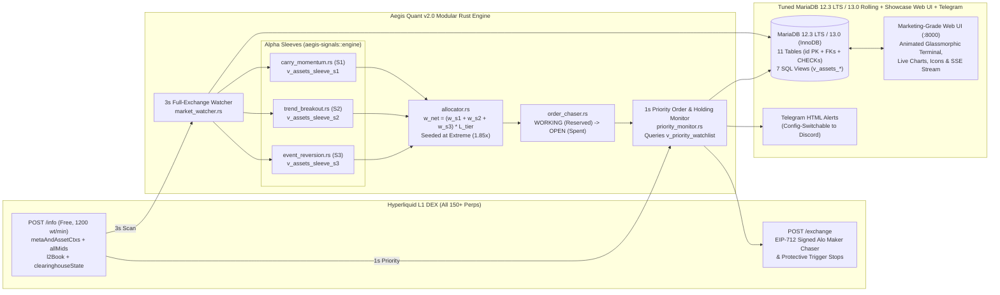

# Aegis Quant v2.0 — Ground-Up Redesign Implementation Plan (Rev 3.1 — Final Approved Spec)

## Goal Description

Replace the legacy **Aegis Quant `v0.3.0-rc1` PP-50 Two-Book (`Pit` + `Pond` + `Settle`)** system with **Aegis Quant `v2.0`**: a ground-up, unified, real-time event-driven quantitative trading platform for **Hyperliquid L1** written in modular, idiomatic Rust, backed by a performance-tuned **MariaDB 12.3 LTS / 13.0 Rolling (Latest Official Release, `InnoDB`)** relational database with strict foreign keys, composite indexes, and SQL views, and paired with a **flagship commercial-grade animated Web UI** and **rich HTML-formatted Telegram alerts**.

### Complete List of Approved Architectural Decisions (Rev 3.1)
1. **GitHub Archiving & Branch Workflow**:
   - Archive current `main` (`v0.3.0-rc1`) to `archive/rust-v0.3.0-rc1` branch and `v0.3.0-rc1-archive` tag on GitHub (`origin`).
   - Create and push a fresh `v2.0` branch on GitHub for all redesign work.
2. **MariaDB 12.3 LTS / 13.0 Rolling (Latest Official Release) + Server & Network Performance Tuning (Option 2 Selected)**:
   - Installs the latest official **MariaDB (`12.3.4 LTS` or `13.0.2 ROLLING` via `MARIADB_VERSION=13.0`)** from the GPG-verified official MariaDB RPM repository (`gpgcheck=1`, `repo_gpgcheck=1`, verified signing key fingerprint `177F4010FE56CA3336300305F1656F24C74CD1D8`) with a dedicated ACID-durable, low-latency configuration (`deploy/99-aegis-mariadb.cnf`): `1GB` RAM buffer pool, **`innodb_flush_log_at_trx_commit = 1`**, **`innodb_log_file_size = 256M`** (MariaDB 10.9–13.0.2 active dynamic redo-log variable; `innodb_redo_log_size` does not exist in MariaDB 13.0.2), `innodb_lock_wait_timeout = 10`, `skip_name_resolve = ON`, Unix socket + `TCP_NODELAY` connection pooling.
3. **Normalized Relational Schema (`id` PK, Foreign Keys, Composite Indexes, Cooldowns & 7 SQL Views)**:
   - Every table uses `id BIGINT PRIMARY KEY AUTO_INCREMENT`, `created_at_ms BIGINT NOT NULL`, and `updated_at_ms BIGINT NOT NULL`.
   - Enforces relational integrity via `asset_id BIGINT NOT NULL REFERENCES exchange_assets(id)` Foreign Keys and covering composite indexes.
   - Includes a dedicated `asset_cooldowns` table and **7 first-class SQL Views**:
     - `v_assets_held`
     - `v_assets_ordered`
     - `v_assets_in_cooldown`
     - `v_assets_sleeve_s1`
     - `v_assets_sleeve_s2`
     - `v_assets_sleeve_s3`
     - `v_priority_watchlist`
4. **Two-Tier Real-Time Market & Order Surveillance (`1s` Priority Loop + `3s` Exchange Scanner)**:
   - **3-Second Full-Exchange Scanner**: Polls `metaAndAssetCtxs` + `allMids` across all 150+ Hyperliquid perps (`$0` cost, ~33% of free IP rate limit).
   - **1-Second Priority Position & Active Order Monitor**: Watches every asset in `v_priority_watchlist` (`WORKING` orders and `OPEN` holdings) every 1 second.
5. **Strict Order-to-Open Capital Lifecycle**:
   - `WORKING` orders reserve margin (`reserved_margin_usdc`) while monitored at 1s frequency.
   - Capital is only deducted/spent from `available_cash_usdc` into `committed_notional_usdc` when the exchange confirms the order is `OPEN`.
6. **Dynamic Cutover Position Handling**:
   - Queries Hyperliquid's live `clearinghouseState` and `openOrders` dynamically at cutover time.
7. **Initial Risk Tier Set to `Extreme (1.85x)`**:
   - Seeded at `risk_tier = "extreme"` (`target_leverage_multiplier = 1.85`), dynamically switchable in `system_config` and the Web UI (`Conservative 0.65x`, `Standard 1.00x`, `Aggressive 1.35x`, `Extreme 1.85x`, `Custom`).
8. **Canonical Hyperliquid Symbols (`"BTC-USDC"`)**:
   - All market symbols use `"<COIN>-USDC"` (`"BTC-USDC"`, `"ETH-USDC"`, `"SOL-USDC"`, `"HYPE-USDC"`).
9. **Strict Modular Rust Naming Convention (Zero-Logic `lib.rs` Policy)**:
   - Every crate's `lib.rs` is strictly a module manifest (`pub mod ...;`). Primary engines live in `engine.rs`, and all subsystems live in focused, reusable module files.
10. **Rich HTML Telegram Alerts (Primary) + Config-Switchable Discord**:
    - Default `alert_provider = "telegram"` using structured HTML cards (`parse_mode = "HTML"`) with aligned monospace blocks, emoji headers, capital reservation/commitment stats, sleeve badges, and stop distances.
11. **Commercial Marketing-Grade Animated Web UI**:
    - Sleek obsidian glassmorphism, neon sleeve accents, custom SVG icons, animated counters, HTML5 Canvas multi-sleeve equity/attribution charts, 1s Priority Watchlist spotlight, and live 150+ perp scanner.



---

## Proposed Changes

### Component 0: GitHub Archive & Branch Initialization

1. Archive the current `v0.3.0-rc1` repository state to GitHub before removing any legacy files:
   ```bash
   git branch archive/rust-v0.3.0-rc1 main
   git push origin archive/rust-v0.3.0-rc1
   git tag -a v0.3.0-rc1-archive -m "Archive Aegis Quant v0.3.0-rc1 Two-Book PP-50 System"
   git push origin v0.3.0-rc1-archive
   ```
2. Create and push the new `v2.0` branch:
   ```bash
   git checkout -b v2.0
   git push -u origin v2.0
   ```

---

### Component 1: Modular Workspace & Core Domain (`Cargo.toml`, `crates/aegis-core`)

#### [MODIFY] [Cargo.toml](file:///home/tony/dev/AEGIS-LOCAL/Cargo.toml)
- Remove `"crates/aegis-pit"`, `"crates/aegis-pond"`, and `"crates/aegis-settle"`.
- Add MariaDB/MySQL driver dependency (`mysql = "25.0"` or `sqlx` with `mysql` + pooling, plus `:memory:` SQLite fallback for isolated unit test fixtures if needed).
- Bump `[workspace.package].version` to `"2.0.0"`.

#### [DELETE] `crates/aegis-pit`, `crates/aegis-pond`, `crates/aegis-settle`, `tests/test_firewall_ast.rs`

#### [MODIFY] `crates/aegis-core/src/` (Modularized: `lib.rs`, `models.rs`, `config.rs`, `security.rs`, `time.rs`, `errors.rs`)
- **`lib.rs`**: Strict 10-line module manifest (`pub mod config; pub mod errors; pub mod models; pub mod security; pub mod time;`).
- **`models.rs`**: Domain structs matching the MariaDB tables and the 7 SQL Views (`HeldAssetView`, `OrderedAssetView`, `CooldownAssetView`, `SleeveAssetView`, `PriorityWatchView`).

---

### Component 2: Latest Official MariaDB (`12.3.4 LTS` / `13.0.2 Rolling`) Upgrade, Performance Tuning, Foreign-Key Schema & 7 SQL Views (`deploy/bootstrap_vm.sh`, `deploy/99-aegis-mariadb.cnf`, `sql/schema_v2_mariadb.sql`, `crates/aegis-db`)

#### [MODIFY] [bootstrap_vm.sh](file:///home/tony/dev/AEGIS-LOCAL/deploy/bootstrap_vm.sh) (GPG-Verified Official MariaDB Server + CSPRNG Least-Privilege Setup)
```bash
# Install MariaDB 13.0 Rolling (or 12.3 LTS) from static GPG-verified repo (gpgcheck=1, repo_gpgcheck=1)
# after verifying key fingerprint 177F4010FE56CA3336300305F1656F24C74CD1D8, generating a 36-char CSPRNG
# password under umask 0077 into /etc/aegis-quant.env (0600 root:root), and applying least-privilege
# grants on aegis_quant.* (no DROP/SUPER/FILE or dev test wildcards unless --enable-dev-test-grants).
```

#### [NEW] `deploy/99-aegis-mariadb.cnf` (MariaDB Server & Network Tuning)
```ini
[mysqld]
bind-address                    = 127.0.0.1
default_time_zone               = '+00:00'

# Memory & InnoDB Durability / Low-Latency Tuning for 1s Priority Loop
innodb_buffer_pool_size         = 1G
innodb_log_file_size            = 256M
innodb_flush_log_at_trx_commit  = 1
innodb_lock_wait_timeout        = 10
innodb_io_capacity              = 2000
innodb_io_capacity_max          = 4000
innodb_read_io_threads          = 4
innodb_write_io_threads         = 4

# Network & Connection Pool Performance
skip_name_resolve               = ON
max_connections                 = 128
thread_cache_size               = 32
table_open_cache                = 2048
query_cache_type                = 0
query_cache_size                = 0
character_set_server            = utf8mb4
collation_server                = utf8mb4_unicode_ci
```

#### [NEW] `sql/schema_v2_mariadb.sql` (11 Core Tables + Foreign Keys + CHECK Constraints + Covering Indexes + 7 SQL Views)
```sql
CREATE DATABASE IF NOT EXISTS aegis_quant
  CHARACTER SET utf8mb4 COLLATE utf8mb4_unicode_ci;
USE aegis_quant;

-- 1. System Config & Fernet-Encrypted Vault
CREATE TABLE IF NOT EXISTS system_config (
    id            BIGINT PRIMARY KEY AUTO_INCREMENT,
    config_key    VARCHAR(128) NOT NULL,
    config_value  TEXT NOT NULL,
    value_type    VARCHAR(32) NOT NULL DEFAULT 'string',
    description   VARCHAR(512) NOT NULL DEFAULT '',
    created_at_ms BIGINT NOT NULL,
    updated_at_ms BIGINT NOT NULL,
    UNIQUE KEY uq_system_config_key (config_key)
) ENGINE=InnoDB;

-- 2. Dynamically Discovered Hyperliquid Perpetual Assets
CREATE TABLE IF NOT EXISTS exchange_assets (
    id                  BIGINT PRIMARY KEY AUTO_INCREMENT,
    symbol              VARCHAR(32) NOT NULL,  -- Canonical: 'BTC-USDC', 'SOL-USDC'
    coin                VARCHAR(24) NOT NULL,  -- Raw coin: 'BTC', 'SOL'
    asset_index         INT UNSIGNED NOT NULL DEFAULT 0,
    sz_decimals         INT UNSIGNED NOT NULL DEFAULT 2,
    tick_size           DOUBLE NOT NULL DEFAULT 0.01,
    lot_step_size       DOUBLE NOT NULL DEFAULT 0.01,
    max_leverage        DOUBLE NOT NULL DEFAULT 20.0,
    mark_price          DOUBLE NOT NULL DEFAULT 0.0,
    mid_price           DOUBLE NOT NULL DEFAULT 0.0,
    oracle_price        DOUBLE NOT NULL DEFAULT 0.0,
    funding_rate_hourly DOUBLE NOT NULL DEFAULT 0.0,
    day_volume_usdc     DOUBLE NOT NULL DEFAULT 0.0,
    open_interest_usdc  DOUBLE NOT NULL DEFAULT 0.0,
    prev_day_price      DOUBLE NOT NULL DEFAULT 0.0,
    is_core_eligible    TINYINT(1) NOT NULL DEFAULT 0,
    is_event_eligible   TINYINT(1) NOT NULL DEFAULT 0,
    is_priority_watched TINYINT(1) NOT NULL DEFAULT 0,
    created_at_ms       BIGINT NOT NULL,
    updated_at_ms       BIGINT NOT NULL,
    UNIQUE KEY uq_exchange_assets_symbol (symbol),
    UNIQUE KEY uq_exchange_assets_coin (coin),
    KEY idx_assets_eligibility_vol (is_core_eligible, is_event_eligible, day_volume_usdc DESC),
    KEY idx_assets_priority (is_priority_watched, updated_at_ms DESC)
) ENGINE=InnoDB;

-- 3. Asset Cooldowns (Post-Stop / Post-Liquidation / Churn Guard)
CREATE TABLE IF NOT EXISTS asset_cooldowns (
    id              BIGINT PRIMARY KEY AUTO_INCREMENT,
    asset_id        BIGINT NOT NULL,
    cooldown_type   VARCHAR(32) NOT NULL, -- 'STOP_OUT', 'VOL_SHOCK', 'CHURN_GUARD', 'MANUAL'
    reason          VARCHAR(255) NOT NULL,
    triggered_at_ms BIGINT NOT NULL,
    expires_at_ms   BIGINT NOT NULL,
    is_active       TINYINT(1) NOT NULL DEFAULT 1,
    created_at_ms   BIGINT NOT NULL,
    updated_at_ms   BIGINT NOT NULL,
    CONSTRAINT fk_cooldowns_asset FOREIGN KEY (asset_id) REFERENCES exchange_assets(id) ON DELETE CASCADE,
    KEY idx_cooldowns_active_exp (is_active, expires_at_ms, asset_id)
) ENGINE=InnoDB;

-- 4. Historical & Live OHLCV Candle Series (1h and 4h)
CREATE TABLE IF NOT EXISTS ohlcv_bars (
    id            BIGINT PRIMARY KEY AUTO_INCREMENT,
    asset_id      BIGINT NOT NULL,
    timeframe     VARCHAR(8) NOT NULL,
    timestamp_ms  BIGINT NOT NULL,
    open          DOUBLE NOT NULL,
    high          DOUBLE NOT NULL,
    low           DOUBLE NOT NULL,
    close         DOUBLE NOT NULL,
    volume        DOUBLE NOT NULL,
    funding_rate  DOUBLE NOT NULL DEFAULT 0.0,
    created_at_ms BIGINT NOT NULL,
    updated_at_ms BIGINT NOT NULL,
    CONSTRAINT fk_bars_asset FOREIGN KEY (asset_id) REFERENCES exchange_assets(id) ON DELETE CASCADE,
    UNIQUE KEY uq_bars_asset_tf_ts (asset_id, timeframe, timestamp_ms),
    KEY idx_bars_tf_ts (timeframe, timestamp_ms DESC)
) ENGINE=InnoDB;

-- 5. Latest Per-Asset Multi-Sleeve Signals & Target Weights
CREATE TABLE IF NOT EXISTS sleeve_signals (
    id                   BIGINT PRIMARY KEY AUTO_INCREMENT,
    asset_id             BIGINT NOT NULL,
    mark_price           DOUBLE NOT NULL,
    day_volume_usdc      DOUBLE NOT NULL,
    funding_rate_hourly  DOUBLE NOT NULL,
    annualized_vol       DOUBLE NOT NULL,
    market_beta          DOUBLE NOT NULL,
    s1_mom_score         DOUBLE NOT NULL DEFAULT 0.0,
    s1_carry_score       DOUBLE NOT NULL DEFAULT 0.0,
    s2_trend_alignment   INT NOT NULL DEFAULT 0,
    s2_vol_surge_ratio   DOUBLE NOT NULL DEFAULT 1.0,
    s3_funding_zscore    DOUBLE NOT NULL DEFAULT 0.0,
    s3_flush_atr_mult    DOUBLE NOT NULL DEFAULT 0.0,
    w_s1_carry_mom       DOUBLE NOT NULL DEFAULT 0.0,
    w_s2_trend_breakout  DOUBLE NOT NULL DEFAULT 0.0,
    w_s3_event_reversion DOUBLE NOT NULL DEFAULT 0.0,
    raw_combined_weight  DOUBLE NOT NULL DEFAULT 0.0,
    target_weight        DOUBLE NOT NULL DEFAULT 0.0,
    current_weight       DOUBLE NOT NULL DEFAULT 0.0,
    delta_weight         DOUBLE NOT NULL DEFAULT 0.0,
    event_trigger        VARCHAR(64),
    rebalance_action     VARCHAR(32) NOT NULL DEFAULT 'HOLD',
    created_at_ms        BIGINT NOT NULL,
    updated_at_ms        BIGINT NOT NULL,
    CONSTRAINT fk_signals_asset FOREIGN KEY (asset_id) REFERENCES exchange_assets(id) ON DELETE CASCADE,
    UNIQUE KEY uq_signals_asset (asset_id),
    KEY idx_signals_target_weight (target_weight DESC),
    KEY idx_signals_s1 (w_s1_carry_mom DESC),
    KEY idx_signals_s2 (w_s2_trend_breakout DESC),
    KEY idx_signals_s3 (w_s3_event_reversion DESC),
    KEY idx_signals_event_trigger (event_trigger)
) ENGINE=InnoDB;

-- 6. Working Orders & Unified Positions (WORKING reserves margin; OPEN commits funds)
CREATE TABLE IF NOT EXISTS positions (
    id                        BIGINT PRIMARY KEY AUTO_INCREMENT,
    asset_id                  BIGINT NOT NULL,
    client_order_id           VARCHAR(64) NOT NULL,
    side                      ENUM('LONG', 'SHORT') NOT NULL,
    status                    ENUM('WORKING', 'OPEN', 'CLOSED', 'CANCELLED') NOT NULL,
    fsm_state                 VARCHAR(32) NOT NULL DEFAULT 'WORKING_ALO',
    entry_price               DOUBLE NOT NULL,
    current_price             DOUBLE NOT NULL,
    exit_price                DOUBLE,
    requested_quantity        DOUBLE NOT NULL,
    filled_quantity           DOUBLE NOT NULL DEFAULT 0.0,
    reserved_margin_usdc      DOUBLE NOT NULL DEFAULT 0.0, -- Reserved while WORKING
    committed_notional_usdc   DOUBLE NOT NULL DEFAULT 0.0, -- Committed once OPEN
    portfolio_weight          DOUBLE NOT NULL DEFAULT 0.0,
    s1_weight_contrib         DOUBLE NOT NULL DEFAULT 0.0,
    s2_weight_contrib         DOUBLE NOT NULL DEFAULT 0.0,
    s3_weight_contrib         DOUBLE NOT NULL DEFAULT 0.0,
    protective_stop_px        DOUBLE NOT NULL DEFAULT 0.0,
    protective_stop_oid       VARCHAR(64),
    highest_price_seen        DOUBLE NOT NULL DEFAULT 0.0,
    lowest_price_seen         DOUBLE NOT NULL DEFAULT 0.0,
    chase_count               INT UNSIGNED NOT NULL DEFAULT 0,
    realized_pnl_usdc         DOUBLE NOT NULL DEFAULT 0.0,
    unrealized_pnl_usdc       DOUBLE NOT NULL DEFAULT 0.0,
    fees_paid_usdc            DOUBLE NOT NULL DEFAULT 0.0,
    funding_accrued_usdc      DOUBLE NOT NULL DEFAULT 0.0,
    slippage_paid_usdc        DOUBLE NOT NULL DEFAULT 0.0,
    exchange_order_id         VARCHAR(64),
    created_at_ms             BIGINT NOT NULL,
    opened_at_ms              BIGINT,
    closed_at_ms              BIGINT,
    updated_at_ms             BIGINT NOT NULL,
    exit_reason               VARCHAR(64),
    CONSTRAINT fk_positions_asset FOREIGN KEY (asset_id) REFERENCES exchange_assets(id),
    UNIQUE KEY uq_positions_client_oid (client_order_id),
    KEY idx_positions_status_asset (status, asset_id),
    KEY idx_positions_opened (opened_at_ms DESC)
) ENGINE=InnoDB;

-- 7. Maker Limit Chaser 1s Order Monitoring & State Transition Audit
CREATE TABLE IF NOT EXISTS order_audit (
    id                BIGINT PRIMARY KEY AUTO_INCREMENT,
    position_id       BIGINT NOT NULL,
    asset_id          BIGINT NOT NULL,
    client_order_id   VARCHAR(64) NOT NULL,
    side              ENUM('LONG', 'SHORT') NOT NULL,
    from_state        VARCHAR(32) NOT NULL,
    to_state          VARCHAR(32) NOT NULL,
    requested_qty     DOUBLE NOT NULL,
    filled_qty        DOUBLE NOT NULL,
    limit_price       DOUBLE NOT NULL,
    avg_fill_price    DOUBLE NOT NULL,
    reserved_usdc     DOUBLE NOT NULL DEFAULT 0.0,
    committed_usdc    DOUBLE NOT NULL DEFAULT 0.0,
    fees_usdc         DOUBLE NOT NULL DEFAULT 0.0,
    reason            VARCHAR(255) NOT NULL DEFAULT '',
    created_at_ms     BIGINT NOT NULL,
    updated_at_ms     BIGINT NOT NULL,
    CONSTRAINT fk_audit_position FOREIGN KEY (position_id) REFERENCES positions(id) ON DELETE CASCADE,
    CONSTRAINT fk_audit_asset FOREIGN KEY (asset_id) REFERENCES exchange_assets(id),
    KEY idx_audit_position_created (position_id, created_at_ms DESC),
    KEY idx_audit_client_oid (client_order_id)
) ENGINE=InnoDB;

-- 8. Unified Portfolio Snapshots & Sleeve Attribution Curve
CREATE TABLE IF NOT EXISTS portfolio_snapshots (
    id                        BIGINT PRIMARY KEY AUTO_INCREMENT,
    total_equity_usdc         DOUBLE NOT NULL,
    available_cash_usdc       DOUBLE NOT NULL,
    reserved_order_cash_usdc  DOUBLE NOT NULL,
    committed_notional_usdc   DOUBLE NOT NULL,
    net_notional_usdc         DOUBLE NOT NULL,
    gross_leverage_x          DOUBLE NOT NULL,
    net_leverage_x            DOUBLE NOT NULL,
    market_beta_exposure      DOUBLE NOT NULL,
    market_breadth_bull       DOUBLE NOT NULL,
    market_regime_label       VARCHAR(32) NOT NULL,
    risk_tier                 VARCHAR(32) NOT NULL,
    leverage_multiplier       DOUBLE NOT NULL,
    s1_gross_weight           DOUBLE NOT NULL DEFAULT 0.0,
    s2_gross_weight           DOUBLE NOT NULL DEFAULT 0.0,
    s3_gross_weight           DOUBLE NOT NULL DEFAULT 0.0,
    working_order_count       INT NOT NULL DEFAULT 0,
    open_long_count           INT NOT NULL DEFAULT 0,
    open_short_count          INT NOT NULL DEFAULT 0,
    eligible_coin_count       INT NOT NULL DEFAULT 0,
    created_at_ms             BIGINT NOT NULL,
    updated_at_ms             BIGINT NOT NULL,
    KEY idx_snapshots_created (created_at_ms DESC)
) ENGINE=InnoDB;

-- 9. Operational Telemetry Logs
CREATE TABLE IF NOT EXISTS telemetry_logs (
    id            BIGINT PRIMARY KEY AUTO_INCREMENT,
    level         VARCHAR(16) NOT NULL,
    component     VARCHAR(64) NOT NULL,
    message       TEXT NOT NULL,
    details_json  JSON,
    created_at_ms BIGINT NOT NULL,
    updated_at_ms BIGINT NOT NULL,
    KEY idx_telemetry_level_created (level, created_at_ms DESC)
) ENGINE=InnoDB;

-- 10. Alert Queue (Telegram Primary, Config-Switchable to Discord)
CREATE TABLE IF NOT EXISTS alert_queue (
    id            BIGINT PRIMARY KEY AUTO_INCREMENT,
    provider      VARCHAR(24) NOT NULL DEFAULT 'telegram',
    event_type    VARCHAR(64) NOT NULL,
    severity      VARCHAR(16) NOT NULL,
    message       TEXT NOT NULL,
    payload_json  JSON,
    status        VARCHAR(24) NOT NULL DEFAULT 'PENDING',
    attempts      INT NOT NULL DEFAULT 0,
    next_retry_ms BIGINT NOT NULL DEFAULT 0,
    created_at_ms BIGINT NOT NULL,
    updated_at_ms BIGINT NOT NULL,
    KEY idx_alerts_status_retry (status, next_retry_ms)
) ENGINE=InnoDB;

-- 11. Reconciled Hyperliquid Per-Event Funding Ledger (windowed open-position PnL attribution)
CREATE TABLE IF NOT EXISTS funding_events (
    id             BIGINT PRIMARY KEY AUTO_INCREMENT,
    asset_id       BIGINT NOT NULL,
    coin           VARCHAR(24) NOT NULL,
    event_time_ms  BIGINT NOT NULL,
    usdc           DECIMAL(20,8) NOT NULL,
    remaining_usdc DECIMAL(20,8) NOT NULL,
    position_szi   DECIMAL(20,8) NOT NULL DEFAULT 0.00000000,
    funding_rate   DECIMAL(20,10) NOT NULL DEFAULT 0.0000000000,
    dedup_key      VARCHAR(128) NOT NULL,
    created_at_ms  BIGINT NOT NULL,
    updated_at_ms  BIGINT NOT NULL,
    CONSTRAINT fk_funding_asset FOREIGN KEY (asset_id) REFERENCES exchange_assets(id) ON DELETE CASCADE,
    UNIQUE KEY uq_funding_dedup (dedup_key),
    KEY idx_funding_asset_time (asset_id, event_time_ms DESC),
    KEY idx_funding_time (event_time_ms DESC)
) ENGINE=InnoDB;

-- ============================================================================
-- FIRST-CLASS SQL VIEWS (Utilizing Foreign Keys & Covering Indexes)
-- ============================================================================

-- View 1: v_assets_held (All active OPEN holdings with live mark, stop distance & sleeve attribution)
CREATE OR REPLACE VIEW v_assets_held AS
SELECT
    p.id AS position_id,
    a.id AS asset_id,
    a.symbol,
    a.coin,
    p.client_order_id,
    p.side,
    p.filled_quantity AS quantity,
    p.committed_notional_usdc,
    p.portfolio_weight,
    p.entry_price,
    a.mark_price,
    p.protective_stop_px,
    CASE
        WHEN p.protective_stop_px > 0 AND a.mark_price > 0
        THEN ROUND(ABS(a.mark_price - p.protective_stop_px) / a.mark_price * 100.0, 2)
        ELSE NULL
    END AS stop_distance_pct,
    p.highest_price_seen,
    p.lowest_price_seen,
    p.unrealized_pnl_usdc,
    p.realized_pnl_usdc,
    p.funding_accrued_usdc,
    p.fees_paid_usdc,
    p.s1_weight_contrib,
    p.s2_weight_contrib,
    p.s3_weight_contrib,
    s.target_weight AS latest_target_weight,
    s.delta_weight AS latest_delta_weight,
    p.opened_at_ms,
    p.updated_at_ms
FROM positions p
INNER JOIN exchange_assets a ON a.id = p.asset_id
LEFT JOIN sleeve_signals s ON s.asset_id = a.id
WHERE p.status = 'OPEN';

-- View 2: v_assets_ordered (All WORKING Maker Limit Chaser orders with reserved margin & book distance)
CREATE OR REPLACE VIEW v_assets_ordered AS
SELECT
    p.id AS position_id,
    a.id AS asset_id,
    a.symbol,
    a.coin,
    p.client_order_id,
    p.exchange_order_id,
    p.side,
    p.fsm_state,
    p.requested_quantity,
    p.filled_quantity,
    p.reserved_margin_usdc,
    p.entry_price AS limit_price,
    a.mid_price,
    a.mark_price,
    CASE
        WHEN a.mid_price > 0
        THEN ROUND((a.mid_price - p.entry_price) / a.mid_price * 10000.0, 2)
        ELSE 0.0
    END AS distance_from_mid_bps,
    p.chase_count,
    p.s1_weight_contrib,
    p.s2_weight_contrib,
    p.s3_weight_contrib,
    p.created_at_ms,
    p.updated_at_ms
FROM positions p
INNER JOIN exchange_assets a ON a.id = p.asset_id
WHERE p.status = 'WORKING';

-- View 3: v_assets_in_cooldown (Assets currently blocked by active post-stop / shock / churn cooldown)
CREATE OR REPLACE VIEW v_assets_in_cooldown AS
SELECT
    c.id AS cooldown_id,
    a.id AS asset_id,
    a.symbol,
    a.coin,
    c.cooldown_type,
    c.reason,
    c.triggered_at_ms,
    c.expires_at_ms,
    GREATEST(0, ROUND((c.expires_at_ms - (UNIX_TIMESTAMP(NOW(3)) * 1000)) / 1000, 0)) AS remaining_seconds,
    c.updated_at_ms
FROM asset_cooldowns c
INNER JOIN exchange_assets a ON a.id = c.asset_id
WHERE c.is_active = 1
  AND c.expires_at_ms > (UNIX_TIMESTAMP(NOW(3)) * 1000);

-- View 4: v_assets_sleeve_s1 (Sleeve 1: Cross-Sectional Carry-Momentum & Market-Beta Hedge)
CREATE OR REPLACE VIEW v_assets_sleeve_s1 AS
SELECT
    a.id AS asset_id,
    a.symbol,
    a.coin,
    a.mark_price,
    a.day_volume_usdc,
    a.funding_rate_hourly,
    ROUND(a.funding_rate_hourly * 24.0 * 365.0 * 100.0, 2) AS funding_apr_pct,
    s.annualized_vol,
    s.market_beta,
    s.s1_mom_score,
    s.s1_carry_score,
    s.w_s1_carry_mom,
    s.target_weight,
    s.current_weight,
    s.updated_at_ms
FROM sleeve_signals s
INNER JOIN exchange_assets a ON a.id = s.asset_id
WHERE a.is_core_eligible = 1 OR ABS(s.w_s1_carry_mom) > 1e-6
ORDER BY ABS(s.w_s1_carry_mom) DESC, a.day_volume_usdc DESC;

-- View 5: v_assets_sleeve_s2 (Sleeve 2: Breadth-Confirmed Multi-Speed Trend & Live 3s Breakout)
CREATE OR REPLACE VIEW v_assets_sleeve_s2 AS
SELECT
    a.id AS asset_id,
    a.symbol,
    a.coin,
    a.mark_price,
    a.day_volume_usdc,
    s.annualized_vol,
    s.s2_trend_alignment,
    s.s2_vol_surge_ratio,
    s.w_s2_trend_breakout,
    s.event_trigger,
    s.target_weight,
    s.current_weight,
    s.updated_at_ms
FROM sleeve_signals s
INNER JOIN exchange_assets a ON a.id = s.asset_id
WHERE a.is_core_eligible = 1 OR ABS(s.w_s2_trend_breakout) > 1e-6
ORDER BY ABS(s.w_s2_trend_breakout) DESC, s.s2_vol_surge_ratio DESC;

-- View 6: v_assets_sleeve_s3 (Sleeve 3: Live Capitulation Flush & Funding Dislocation Harvester)
CREATE OR REPLACE VIEW v_assets_sleeve_s3 AS
SELECT
    a.id AS asset_id,
    a.symbol,
    a.coin,
    a.mark_price,
    a.day_volume_usdc,
    a.funding_rate_hourly,
    ROUND(a.funding_rate_hourly * 24.0 * 365.0 * 100.0, 2) AS funding_apr_pct,
    s.s3_funding_zscore,
    s.s3_flush_atr_mult,
    s.w_s3_event_reversion,
    s.event_trigger,
    s.target_weight,
    s.current_weight,
    s.updated_at_ms
FROM sleeve_signals s
INNER JOIN exchange_assets a ON a.id = s.asset_id
WHERE a.is_event_eligible = 1 OR ABS(s.w_s3_event_reversion) > 1e-6
ORDER BY ABS(s.w_s3_event_reversion) DESC, s.s3_funding_zscore ASC;

-- View 7: v_priority_watchlist (All assets under 1-Second High-Frequency Surveillance)
CREATE OR REPLACE VIEW v_priority_watchlist AS
SELECT
    a.id AS asset_id,
    a.symbol,
    a.coin,
    a.mark_price,
    a.mid_price,
    a.funding_rate_hourly,
    p.id AS position_id,
    p.status AS position_status,
    p.side AS position_side,
    p.fsm_state,
    p.entry_price,
    p.requested_quantity,
    p.filled_quantity,
    p.reserved_margin_usdc,
    p.committed_notional_usdc,
    p.protective_stop_px,
    p.unrealized_pnl_usdc,
    s.target_weight,
    s.event_trigger,
    a.updated_at_ms
FROM exchange_assets a
LEFT JOIN positions p ON p.asset_id = a.id AND p.status IN ('WORKING', 'OPEN')
LEFT JOIN sleeve_signals s ON s.asset_id = a.id
WHERE a.is_priority_watched = 1
   OR p.id IS NOT NULL
   OR s.event_trigger IS NOT NULL;
```

#### [MODIFY] `crates/aegis-db/src/` (Modularized Repository Layer Querying Views & Tables)
- `lib.rs` (module manifest only)
- `engine.rs` (MariaDB connection pool with Unix socket / `TCP_NODELAY` + schema initializer)
- `views_repo.rs` (`get_assets_held()`, `get_assets_ordered()`, `get_assets_in_cooldown()`, `get_sleeve_s1_view()`, `get_sleeve_s2_view()`, `get_sleeve_s3_view()`, `get_priority_watchlist()`)
- `assets_repo.rs`, `bars_repo.rs`, `signals_repo.rs`, `positions_repo.rs`, `orders_repo.rs`, `cooldowns_repo.rs`, `portfolio_repo.rs`, `config_repo.rs`, `fernet.rs`, `backup.rs`

---

### Component 3: Two-Tier Live Market Watcher (`3s`) & Priority Monitor (`1s`) (`crates/aegis-execution`)

Modularized into `engine.rs`, `market_watcher.rs`, `priority_monitor.rs`, `order_chaser.rs`, `signing.rs`, `reconcile.rs`, and `http_client.rs`.
- **`market_watcher.rs` (3s Full-Exchange Loop)**: Discovers and updates all 150+ Hyperliquid perps via `metaAndAssetCtxs`, normalizes symbols to `"<COIN>-USDC"`, updates `exchange_assets`, and expires finished cooldowns in `asset_cooldowns`.
- **`priority_monitor.rs` (1s High-Frequency Loop)**: Queries `v_priority_watchlist` every 1 second:
  - Chases `WORKING` orders (`v_assets_ordered`) at top-of-book; transitions `WORKING -> OPEN` upon fill confirmation (moving funds from `reserved_margin_usdc` to `committed_notional_usdc` and deducting `available_cash_usdc`).
  - Monitors `OPEN` holdings (`v_assets_held`) every 1 second to ratchet high-water trailing stops and execute immediate exits on stop breach (inserting a post-stop cooldown into `asset_cooldowns` so the coin is not immediately re-entered on noise).

---

### Component 4: Modular Multi-Sleeve Signal Engine (`crates/aegis-signals`)

Modularized into `engine.rs`, `carry_momentum.rs`, `trend_breakout.rs`, `event_reversion.rs`, `breadth.rs`, and `allocator.rs`.
- Automatically excludes any symbol present in `v_assets_in_cooldown` from new entries.
- Scales netted sleeve weights (`w_s1 + w_s2 + w_s3`) by `RiskTier` (seeded at **`Extreme (1.85x)`**).

---

### Component 5: Rich HTML Telegram Alerts + Config-Switchable Discord (`crates/aegis-alerts`)

Modularized into `engine.rs`, `telegram.rs`, `discord.rs`, `formatter.rs`, and `queue.rs`.

#### [NEW] `crates/aegis-alerts/src/formatter.rs` (Rich HTML Telegram Card Templates)
Formats every operational event using Telegram `parse_mode = "HTML"` for clean visual hierarchy on mobile and desktop:
```text
🟢 <b>AEGIS v2.0 // ORDER FILLED (OPEN)</b>
━━━━━━━━━━━━━━━━━━━━━━
<b>Asset:</b> <code>SOL-USDC</code>  |  <b>Side:</b> <code>LONG 📈</code>
<b>Risk Tier:</b> <code>🔥 EXTREME (1.85x)</code>
<b>Trigger:</b> <code>LIVE_BREAKOUT_SURGE</code>

<pre>
Fill Price   : $184.2500
Filled Qty   : 14.50 SOL
Committed    : $2,671.63 USDC (26.7% Eq)
Avail Cash   : $7,328.37 USDC
Protect Stop : $176.8000 (-4.04%)
</pre>
<b>Sleeve Mix:</b> <code>S1 Carry +11.2%</code> · <code>S2 Trend +15.5%</code> · <code>S3 Event 0.0%</code>
⏱ <i>2026-11-19 02:05:12 UTC · 1s Priority Watch Active</i>
```

---

### Component 6: Commercial Marketing-Grade Web Dashboard (`crates/aegis-web`, `web/static/`)

Modularized backend (`server.rs`, `routes.rs`, `handlers.rs`, `payloads.rs`, `auth.rs`, `stream.rs`) directly backed by the 7 MariaDB views (`v_assets_held`, `v_assets_ordered`, `v_assets_in_cooldown`, `v_assets_sleeve_s1/s2/s3`, `v_priority_watchlist`), serving `web/static/index.html`, `web/static/styles.css`, and `web/static/app.js`.

---

### Operational Security & Wallet Posture (v2.1 Hardening)

- **`AEGIS_DB_URL` Mandatory Configuration**: Production binaries (`DatabaseManager::connect`) require `AEGIS_DB_URL` (or `$CREDENTIALS_DIRECTORY/aegis_db_url`) and fail closed with zero hardcoded default credentials; isolated test runs (`DatabaseManager::new_isolated_test`) read `AEGIS_TEST_DB_URL` or `AEGIS_DB_URL`.
- **`db --init` Auto-Provisioned `web_api_token` & Loopback Auth-by-Default**: `aegis-web` enforces Bearer/cookie authentication across all `/api/v1/*` endpoints (except `/api/v1/health` and `/api/v1/auth/login`), including `127.0.0.1` loopback binds unless explicitly disabled via DB-immutable `web_auth_enabled=false`. `aegis-quant db --init` auto-provisions a random 32-byte Fernet-encrypted `web_api_token` if unset/empty and prints it once at provisioning time without logging secrets in steady state.
- **Monitoring-Only `hyperliquid_vault_address`**: Configured `hyperliquid_vault_address` (`vault_role`, `vault_target_allocation_pct`, `vault_profit_sweep_threshold_usdc`) is strictly read-only/monitoring; all trading requests pass `vaultAddress: null`, and vault equity remains segregated from perp sizing margin.
- **Hyperliquid API Agent Wallet Setup & Expiry Best Practice**: Register a dedicated Trade-Only API Agent Wallet on Hyperliquid under master `wallet_address` (`hyperliquid_agent_address`), storing only the agent `private_key` (Fernet-encrypted). Rotate agent wallets before Hyperliquid expiry (up to 180 days; startup `extraAgents` check warns within 7 days of expiry).
- **MariaDB 13.0 Durability & Redo Log Settings**: `deploy/99-aegis-mariadb.cnf` enforces `innodb_flush_log_at_trx_commit = 1` and `innodb_log_file_size = 256M` (the active dynamic redo-log variable in MariaDB 10.9–13.0.2; `innodb_redo_log_size` is invalid in MariaDB 13.0.2 and `innodb_redo_log_capacity` applies only to Oracle MySQL 8).

---

## Verification Plan

1. **GitHub Archive & Branch Check**: Verify `archive/rust-v0.3.0-rc1` and `v2.0` branches on `origin`.
2. **Latest Official MariaDB (`12.3.4 LTS` / `13.0.2 Rolling`) Service & Schema Verification**:
   - Install from the GPG-verified official MariaDB repo, apply `deploy/99-aegis-mariadb.cnf`, enable/start `mariadb.service`, apply `sql/schema_v2_mariadb.sql`, and verify all 11 tables, Foreign Keys, CHECK constraints, Indexes, and all 7 `v_assets_*` SQL Views.
3. **Rust Workspace Build, Lint & Tests**:
   ```bash
   cargo fmt --all -- --check
   cargo clippy --workspace --all-targets -- -D warnings
   cargo test --workspace
   ```
4. **Live Cutover, Rich Telegram Test Alert & Showroom UI Verification**:
   - Reconcile live Hyperliquid Testnet orders/positions dynamically, start `aegis-quant.service` (`v2.0`), trigger a formatted HTML Telegram test alert, and verify the new animated Web Dashboard on port `8000`.
